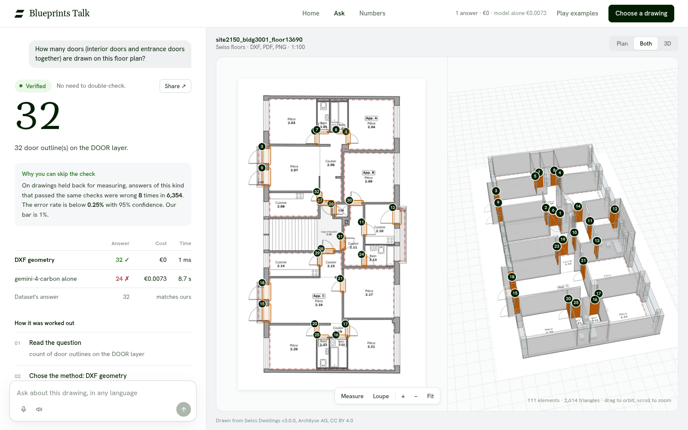

# Blueprints Talk

Answers to questions about construction drawings and building models that a project engineer does not need to double-check. Built at Junction 2026 for Stoa's challenge "Make Blueprints Talk".

Every answer ends in one of three states:

- **Verified**: no need to double-check. Backed by a measured error rate on drawings that were held back.
- **Check this**: an answer with its evidence drawn on the drawing, where one of the checks is weak.
- **Can't answer reliably**: no number, with the reason.

Numbers are computed from the drawing's geometry and objects, never written by a language model. Each counted door or measured room is drawn on the plan and lit in 3D, so a person can check an answer in seconds.

## How it works

A router sends each question to the cheapest method that can answer it exactly.

| Drawing | Method | Cost per question |
| --- | --- | --- |
| IFC model, or a plan rendered from one | IfcOpenShell query: enumerated elements, geometry and the model's own quantities | €0 |
| Floor plan with a DXF | Room outlines, door, window and fixture entities from the DXF, cross-checked against the PDF's text | €0 |
| Scan, counting labelled rooms | Local OCR reads the room labels printed on the plan and the code counts them; the apartment's type line (3H+K+S) is the cross-check | €0 |
| Scan, anything else | A vision model points at each item and the code counts the points. Never Verified | a fraction of a cent |

An answer becomes Verified only when its independent checks agree and answers of that kind stayed under 1% wrong (95% upper bound) on a calibration split of drawings that the engines were not built on.

## Results so far

All figures come from the run log in `results/` and are shown live on the app's Numbers page. The test split has not been opened.

| | Vision model alone | This system |
| --- | --- | --- |
| Correct, same 200 development questions | 65.1% | 92.7% |
| Re-weighted to the dataset's question mix | 75.7% | 88.9% |
| Cost per 1,000 questions | €12.41 | €3.23 |

- Swiss floor plans, held-out: counts 99.9% correct (6,346 of 6,354), areas 97.6% (2,962 of 3,034).
- Verified answers on held-out drawings: 8 wrong in 6,354 counts and 6 wrong in 2,612 areas, so the error rate is below 0.25% and 0.53% with 95% confidence.
- Development split, exact engines only, no model: 33,452 of 63,592 questions answered at €0, 94.3% of them right; 18,198 Verified answers, none wrong.
- Scans: where the printed labels and the type line agree, the label engine answers on its own. That is 12.7% of the scan questions on the development split (96.0% right) and 95.7% right on held-out plans (2,072 answers). It is never Verified: its best level is 2.0% wrong on held-out plans, above the 1% bar.
- Not solved yet: symbol counts on scans (doors, windows, toilets, sinks, showers; about a third of the dataset's questions) and the number of floors a scan shows (7%) are answered by the vision model at roughly 80% and are never Verified; IFC answers are not Verified yet because too few were held out to prove 1%; free-text questions about IFC models and the US door schedules have no engine.

The vision model in these runs is Claude Sonnet 5.5, image only, high effort.

## The app



Quiet and light, in the spirit of Stoa's own site. The answer reads like a short document on the left; the drawing it came from is on the right.

- **The answer column:** the question, the state, the figure, why it can be trusted or needs a look, this system beside a vision model alone (answer, cost, time), how it was worked out step by step, and every counted item cut out of the drawing.
- **On the sheet:** a fine ring and a numbered dot on each counted item, a tint and an area plate on each measured room. They appear as a reading line crosses the sheet, and the figure climbs with them. Select any mark to leave it out; the answer follows.
- **In 3D:** a white model with the plan as its floor. A Swiss plan is raised from its DXF; an IFC model is cut open at the storey; an answer spread over several storeys lifts them apart and tallies each one.
- **Checking tools:** inspect the items one by one, measure on the sheet where its scale is known, enlarge the drawing under a loupe, and see a small scan sharper with **Enhance**.
- **Bring your own drawing:** an image or a PDF opens like any other and is read as it came. **Share** makes one image of an answer with its evidence marked.

| | |
| --- | --- |
|  |  |
|  |  |

The left and right arrow keys step through ten prepared examples; "Play examples" runs them on their own.

## Partner technology

Each of these is optional and switches on when its key is in `.env` (see `.env.example`). Without any key the exact engines still answer.

| Partner | What it does here | Status |
| --- | --- | --- |
| Google Gemini | The vision model for scans, and the language model that restates a free-form question so an exact engine can read it. The number still comes from geometry, and such an answer is never Verified. | Built; runs on Claude Sonnet until a Gemini key is set |
| Cloudinary | **Enhance:** a small scan is shown enlarged with AI super-resolution, loaded straight from Cloudinary in the format that suits the browser and laid over the original so every mark keeps its place. **Share:** hosts the evidence sheet of an answer and delivers it in the format and quality that suit whoever opens it. | In use, checked against a Cloudinary account |
| ElevenLabs | Reads the answer aloud with a natural voice; the browser's own voice is the fallback. | Built; the key at hand lacks the Text to Speech permission, so the browser's voice speaks for now |
| Anthropic Claude | The stand-in vision and language model in the measurements above. | In use |

**The enlarged scan is for the reader, never for the engine.** The first idea was to enlarge a small scan before the label engine reads it. Measured on 40 small development scans (348 questions, both runs in `results/`, reproduced by `scripts/eval_prepared_scans.py`): read as they came, the engine gave 236 right answers and 28 wrong; read after enlargement, 228 right and 34 wrong. At the score levels the router lets stand on their own, the wrong answers went from 2 to 6 with no more right ones. Super-resolution draws plausible detail, and a plausible label is not evidence. So the engines read every drawing as it came, which is what their error rates were measured on, and the enlarged view carries a note saying what it is.

## Run it

Python 3.11+ and Node 20+.

```bash
# 1. Python package and the dataset preview (0.5 GB)
uv venv && uv pip install -e ".[dev]"        # or: python -m venv .venv && .venv/bin/pip install -e ".[dev]"
bash 02-dataset/download.sh preview

# 2. The web app, built once
cd web && npm install && npm run build && cd ..

# 3. The app and its API on http://127.0.0.1:8000
./bp serve
```

The exact engines need no API key. Keys for the optional services go in `.env` (see `.env.example` and Partner technology above). The app spends at most €1 on model calls per server start (`BLUEPRINTS_UI_BUDGET_EUR`).

Other commands:

```bash
./bp ask <drawing> "<question>" --out answer.png   # one question, evidence drawn to a PNG
./bp run router --split dev                        # evaluate and log a run to results/
./bp calibrate                                     # set the Verified thresholds on the calibration split
.venv/bin/python -m pytest                         # tests
cd web && npm run dev                              # front end with hot reload (API on port 8000)
```

### Docker

The image holds the app, the API and the OCR models, but no drawings: mount the dataset and a cache folder.

```bash
docker build -t blueprints-talk .
docker run --rm -p 8000:8000 --user "$(id -u):$(id -g)" \
  -v "$PWD/data:/app/data:ro" -v "$PWD/cache:/app/cache" --env-file .env blueprints-talk
```

Leave out `--env-file .env` to run without a vision model. The first time a large IFC model is opened its 3D mesh is built, which can take minutes; it is cached after that.

## Layout

| Path | What |
| --- | --- |
| `src/blueprints/engines/` | IFC engine, DXF engine, router |
| `src/blueprints/verify.py` | Calibrated Verified thresholds |
| `src/blueprints/harness.py`, `scoring.py`, `split.py` | Evaluation harness, Stoa's scoring rule, the frozen split by drawing |
| `src/blueprints/server.py`, `mesh.py` | API for the app; 3D meshes from IFC models and DXF plans |
| `src/blueprints/interpret.py`, `cloud.py`, `sheet.py` | Question restating by a language model; Cloudinary enlarged view and hosting; evidence sheets |
| `web/` | The verification app (React, Three.js) |
| `scripts/` | One-off measurements, each logged in `results/` |
| `results/` | Log of every evaluation run |
| `splits/` | The split, the fixed samples and the Verified thresholds |
| `CLAUDE.md`, `01-challenge/` to `04-research/` | Challenge brief, dataset notes, strategy and research |

## Data and licences

The drawings come from Stoa's challenge dataset; each source keeps its own licence (`LICENSE.md` in each source folder) and the app shows the credit under every drawing. CubiCasa5K is non-commercial. Answers are never looked up from the public annotations of CubiCasa5K or Swiss Dwellings.
