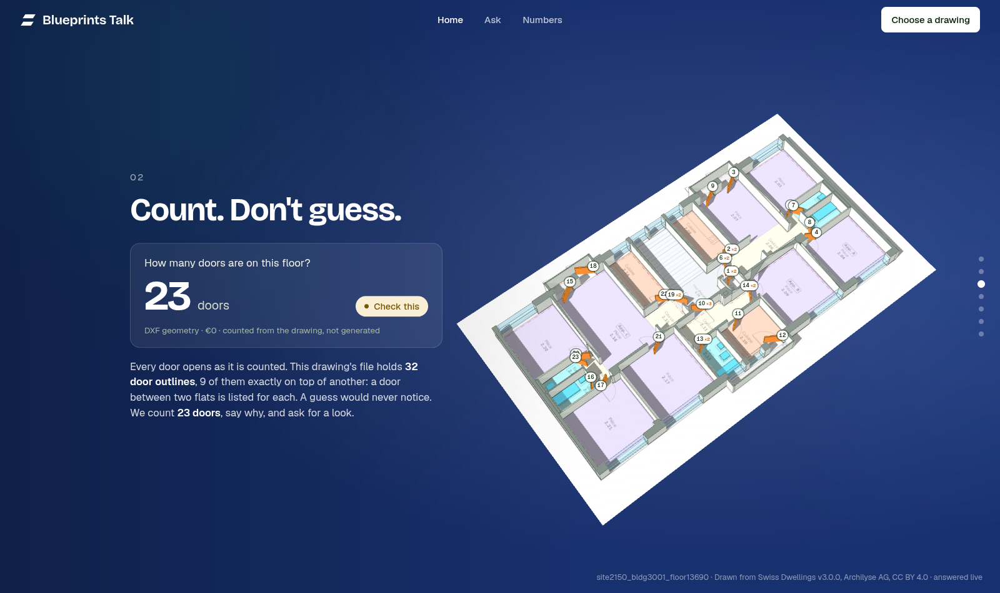
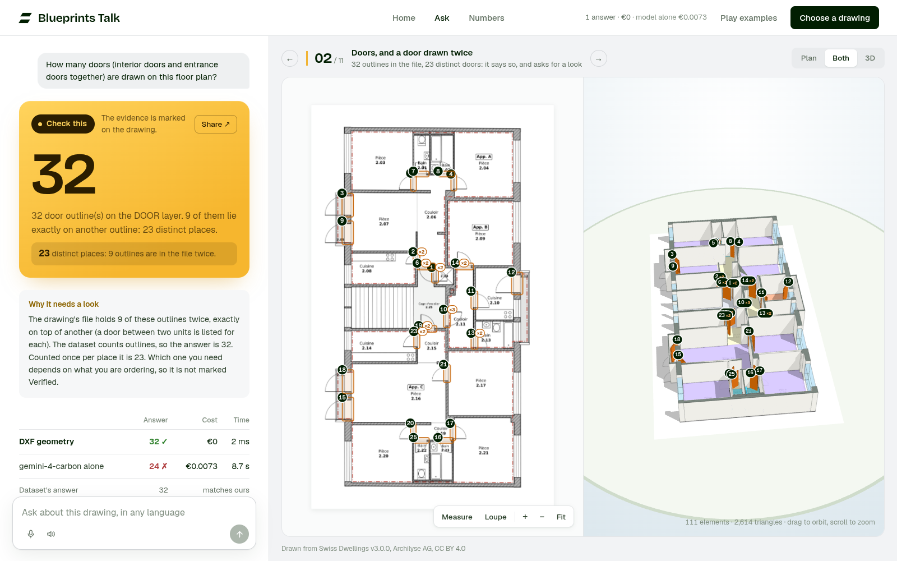
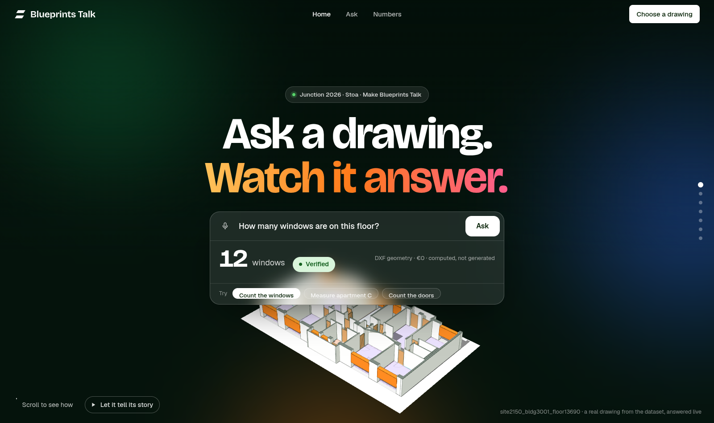
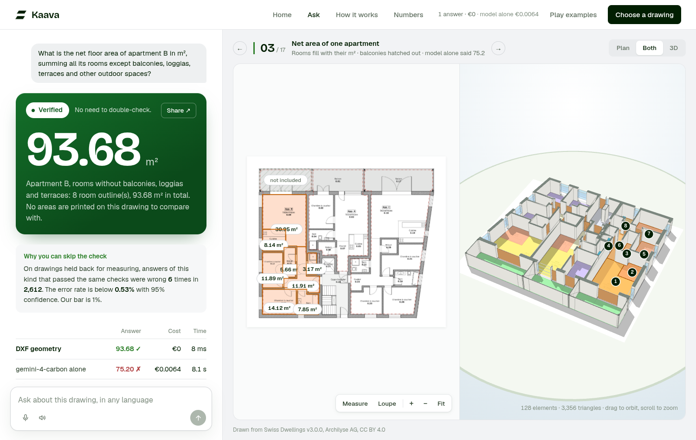
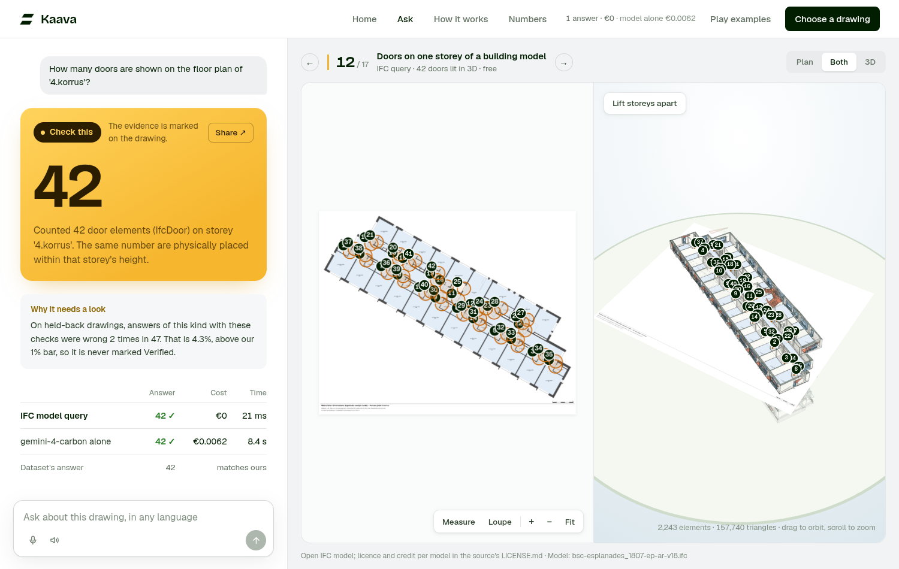
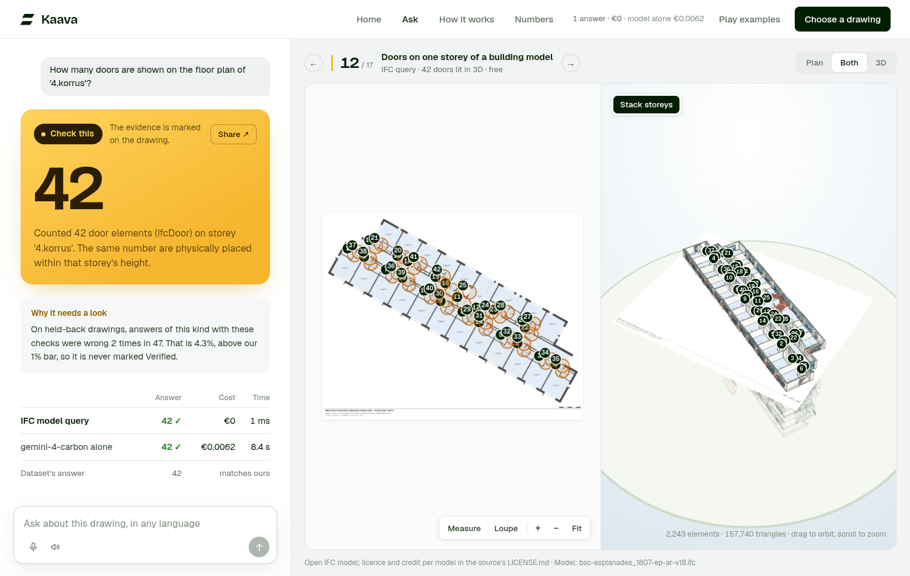
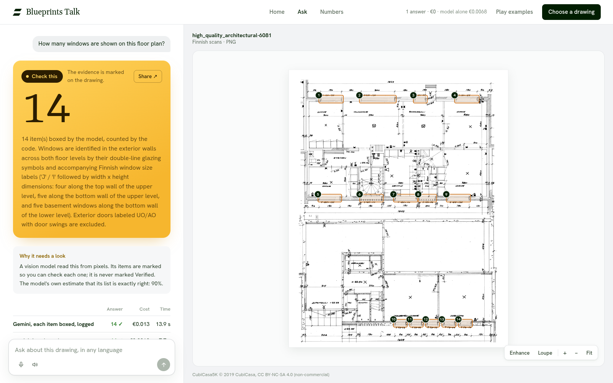

# Blueprints Talk

Answers to questions about construction drawings and building models that a project engineer does not need to double-check. Built at Junction 2026 for Stoa's challenge "Make Blueprints Talk".

Every answer ends in one of three states:

- **Verified**: no need to double-check. Backed by a measured error rate on drawings that were held back.
- **Check this**: an answer with its evidence drawn on the drawing, where one of the checks is weak.
- **Can't answer reliably**: no number, with the reason.

Numbers are computed from the drawing's geometry and objects, never written by a language model. Each counted door or measured room is drawn on the plan and lit in 3D, so a person can check an answer in seconds.

## How it works

A router sends each question to the cheapest method that can answer it exactly.

| Drawing | Method | Cost per question |
| --- | --- | --- |
| IFC model, or a plan rendered from one | IfcOpenShell query: enumerated elements, geometry and the model's own quantities | €0 |
| Floor plan with a DXF | Room outlines, door, window and fixture entities from the DXF, cross-checked against the PDF's text | €0 |
| Scan, counting labelled rooms | Local OCR reads the room labels printed on the plan and the code counts them; the apartment's type line (3H+K+S) is the cross-check | €0 |
| Scan, anything else | A vision model points at each item and the code counts the points. Never Verified | a fraction of a cent |

An answer becomes Verified only when its independent checks agree and answers of that kind stayed under 1% wrong (95% upper bound) on a calibration split of drawings that the engines were not built on.

## Results so far

All figures come from the run log in `results/` and are shown live on the app's Numbers page. The test split has not been opened.

| | Vision model alone | This system |
| --- | --- | --- |
| Correct, same 200 development questions | 62.5% | 95.8% |
| Re-weighted to the dataset's question mix | 77.3% | 95.9% |
| Cost per 1,000 questions | €7.99 | €3.15 |

- The prompt for scans was tuned on that sample's scans, so scans were measured again on 100 questions from development drawings no sample had used: 89.0% right for the system, 90.0% for Gemini marking items on its own. With that figure for scans, the re-weighted total is near 92.6%.

- Swiss floor plans, held-out: counts 99.9% correct (6,346 of 6,354), areas 97.6% (2,962 of 3,034).
- Verified answers on held-out drawings: 8 wrong in 5,710 counts and 6 wrong in 2,612 areas, so the error rate is below 0.28% and 0.53% with 95% confidence.
- Development split, exact engines only, no model: 33,452 of 63,592 questions answered at €0, 94.3% of them right; 16,982 Verified answers, none wrong.
- A door the file holds twice. On the development plans, 128 of 805 door outlines (16%) lie exactly on top of another outline: a door between two units is listed for each. The dataset counts each, so its answer for one floor is 32 doors where the drawing shows 23. The engine answers as the dataset counts, states the number of distinct places beside it, draws each place once (marked ×2 or ×3), and never marks such an answer Verified: a person ordering doors needs the 23. No score measured against the dataset can catch this, since by the dataset's count the answer is right; it is a rule in the engine, and the calibration leaves these answers out.
- Scans: where the printed labels and the type line agree, the label engine answers on its own. That is 12.7% of the scan questions on the development split (96.0% right) and 95.7% right on held-out plans (2,072 answers). It is never Verified: its best level is 2.0% wrong on held-out plans, above the 1% bar.
- Scans, everything else: Gemini draws a box around each item the question asks about and the code counts the boxes, so the number is still a count of things you can see. That is right about nine times in ten and never Verified.
- Scans read twice. We tested whether "the labels and Gemini give the same count" could be Verified, on 800 calibration answers where the label engine was confident. The labels alone were right 94.5% of the time, Gemini 98.3%. They agreed on 762 answers, of which 10 were wrong: 1.3%, better than either alone but above the 1% bar, so it stays Check this. Where they differed (38 answers) Gemini was right 34 times, so its count is shown and the difference is flagged. The second reading is paid for only where it helps: the label engine's strictest answers (labels and type line agree, 97.0% right) stand alone and free; its other confident answers (93.0% right alone) are also counted by Gemini.
- Not solved yet: nothing on a scan is Verified, and scans are two thirds of the dataset's questions; IFC answers are not Verified yet because too few were held out to prove 1%; free-text questions about IFC models and the US door schedules have no engine.

Two cheaper settings were measured on the same 100 fresh scan questions and not adopted: Gemini 4 Hydrogen (85 right against Carbon's 90, and dearer per question because it thinks longer), and half the image budget for Carbon (89 right, 20% cheaper: a fair trade where cost matters more than one answer in a hundred; set `BLUEPRINTS_GEMINI_RESOLUTION=high`).

The vision model in these runs is Gemini 4 Carbon at low thinking. Alone, it sees the image and states a number. In this system it is asked only where no exact engine covers the drawing, and on scans it marks each item instead of stating a number. Low thinking is a measured choice: at high thinking a pilot of 8 questions cost €0.10 and three minutes per question and often ran out of tokens; at low thinking a question costs €0.006 to €0.007 and takes about 8 seconds. Before the Gemini key arrived the same comparison was run with Claude Sonnet 5.5 at high effort: 65.1% alone against 92.7% (75.7% against 88.9% re-weighted), €12.41 against €3.23 per 1,000 questions.

## The app



The landing page opens by itself: a real drawing from the dataset stands up into a painted model and answers a question under a working ask bar, before anyone clicks. Scrolling then tells the story: the drawing lies flat (what a vision model sees), stands up again, opens its doors as they are counted and adds up an apartment's rooms; then a scan appears and Gemini's boxes are drawn on it one by one. The background changes colour with each chapter, and the story ends on the three states and the measured results. Every figure in it is the engine's answer to a real question, asked when the page loads. "Let it tell its story" plays it by itself: the drawing narrates each chapter in the first person (ElevenLabs) while the page scrolls in step.



- **The answer card:** the number stands on the colour of its state: green for Verified, amber for Check this, red for Can't answer reliably. Under it: why it can be trusted or needs a look, this system beside a vision model alone (answer, cost, time), how it was worked out step by step, and every counted item cut out of the drawing.
- **On the sheet:** a fine ring and a numbered dot on each counted item, a tint and an area plate on each measured room. They appear as a reading line crosses the sheet, and the figure climbs with them. Click any mark to leave it out; the answer follows.
- **In 3D:** a painted model in sunlight, standing on the plan as its floor. Rooms are tinted by their use, read from the names printed in them; glass, doors and fixtures have their own colours. A plan's doors stand as thin leaves in their openings, and each opens a little as it is counted. An IFC model is cut open at the storey; an answer spread over several storeys lifts them apart and tallies each one.
- **By voice:** ask aloud, and the drawing answers aloud in the first person ("I count thirty-two doors. Verified.").
- **Checking tools:** inspect the items one by one, measure on the sheet where its scale is known, enlarge the drawing under a loupe, and see a small scan sharper with **Enhance**.
- **Bring your own drawing:** an image or a PDF opens like any other and is read as it came. **Share** makes one image of an answer with its evidence marked.

| | |
| --- | --- |
|  |  |
|  |  |

The left and right arrow keys step through ten prepared examples; "Play examples" runs them on their own.

## Partner technology

Each of these is optional and switches on when its key is in `.env` (see `.env.example`). Without any key the exact engines still answer.

| Partner | What it does here | Status |
| --- | --- | --- |
| Google Gemini | **On scans:** Gemini 4 Carbon boxes each counted item in its native detection format (`[ymin, xmin, ymax, xmax]` on a 0 to 1000 grid); the code counts the boxes and draws them on the sheet, so the number never comes from the model and every item can be checked or left out. **For free-form questions:** Gemini 4 Hydrogen restates the question so an exact engine can read it (about €0.003); the number still comes from geometry, and such an answer is never Verified. | In use; all figures above are measured on it |
| Cloudinary | **Enhance:** a small scan is shown enlarged with AI super-resolution, loaded straight from Cloudinary in the format that suits the browser and laid over the original so every mark keeps its place. **Share:** hosts the evidence sheet of an answer and delivers it in the format and quality that suit whoever opens it. | In use, checked against a Cloudinary account |
| ElevenLabs | Reads the answer aloud with a natural voice (Flash v2.5, about half a second per answer), for hands-busy checking on site; the browser's own voice is the fallback. | In use, checked against an ElevenLabs account |
| Anthropic Claude | The vision and language model when no Gemini key is set, and the model of the earlier measurements. | Fallback |

**The enlarged scan is for the reader, never for the engine.** The first idea was to enlarge a small scan before the label engine reads it. Measured on 40 small development scans (348 questions, both runs in `results/`, reproduced by `scripts/eval_prepared_scans.py`): read as they came, the engine gave 236 right answers and 28 wrong; read after enlargement, 228 right and 34 wrong. At the score levels the router lets stand on their own, the wrong answers went from 2 to 6 with no more right ones. Super-resolution draws plausible detail, and a plausible label is not evidence. So the engines read every drawing as it came, which is what their error rates were measured on, and the enlarged view carries a note saying what it is.



## Run it

Python 3.11+ and Node 20+.

```bash
# 1. Python package and the dataset preview (0.5 GB)
uv venv && uv pip install -e ".[dev]"        # or: python -m venv .venv && .venv/bin/pip install -e ".[dev]"
bash 02-dataset/download.sh preview

# 2. The web app, built once
cd web && npm install && npm run build && cd ..

# 3. The app and its API on http://127.0.0.1:8000
./bp serve
```

The exact engines need no API key. Keys for the optional services go in `.env` (see `.env.example` and Partner technology above). The app spends at most €1 on model calls per server start (`BLUEPRINTS_UI_BUDGET_EUR`).

Other commands:

```bash
./bp ask <drawing> "<question>" --out answer.png   # one question, evidence drawn to a PNG
./bp run router --split dev                        # evaluate and log a run to results/
./bp calibrate                                     # set the Verified thresholds on the calibration split
.venv/bin/python -m pytest                         # tests
cd web && npm run dev                              # front end with hot reload (API on port 8000)
```

### Docker

The image holds the app, the API and the OCR models, but no drawings: mount the dataset and a cache folder.

```bash
docker build -t blueprints-talk .
docker run --rm -p 8000:8000 --user "$(id -u):$(id -g)" \
  -v "$PWD/data:/app/data:ro" -v "$PWD/cache:/app/cache" --env-file .env blueprints-talk
```

Leave out `--env-file .env` to run without a vision model. The first time a large IFC model is opened its 3D mesh is built, which can take minutes; it is cached after that.

## Layout

| Path | What |
| --- | --- |
| `src/blueprints/engines/` | IFC engine, DXF engine, router |
| `src/blueprints/verify.py` | Calibrated Verified thresholds |
| `src/blueprints/harness.py`, `scoring.py`, `split.py` | Evaluation harness, Stoa's scoring rule, the frozen split by drawing |
| `src/blueprints/server.py`, `mesh.py` | API for the app; 3D meshes from IFC models and DXF plans |
| `src/blueprints/interpret.py`, `cloud.py`, `sheet.py` | Question restating by a language model; Cloudinary enlarged view and hosting; evidence sheets |
| `web/` | The verification app (React, Three.js) |
| `scripts/` | One-off measurements, each logged in `results/` |
| `pitch/` | The pitch deck (`node pitch/build.mjs`), the narrated video (`pitch/video/make.py`) and the submission text |
| `results/` | Log of every evaluation run |
| `splits/` | The split, the fixed samples and the Verified thresholds |
| `CLAUDE.md`, `01-challenge/` to `04-research/` | Challenge brief, dataset notes, strategy and research |

## Data and licences

The drawings come from Stoa's challenge dataset; each source keeps its own licence (`LICENSE.md` in each source folder) and the app shows the credit under every drawing. CubiCasa5K is non-commercial. Answers are never looked up from the public annotations of CubiCasa5K or Swiss Dwellings.

The code is under the MIT licence (`LICENSE`). The drawings are not part of it.
