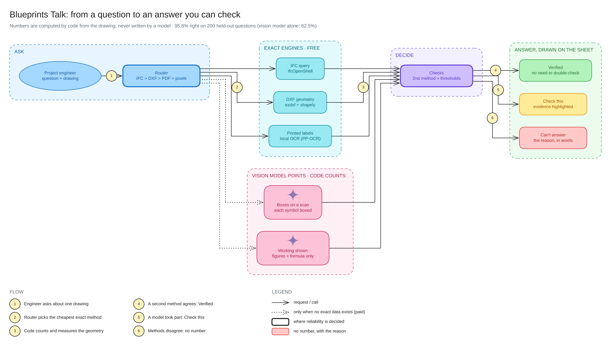
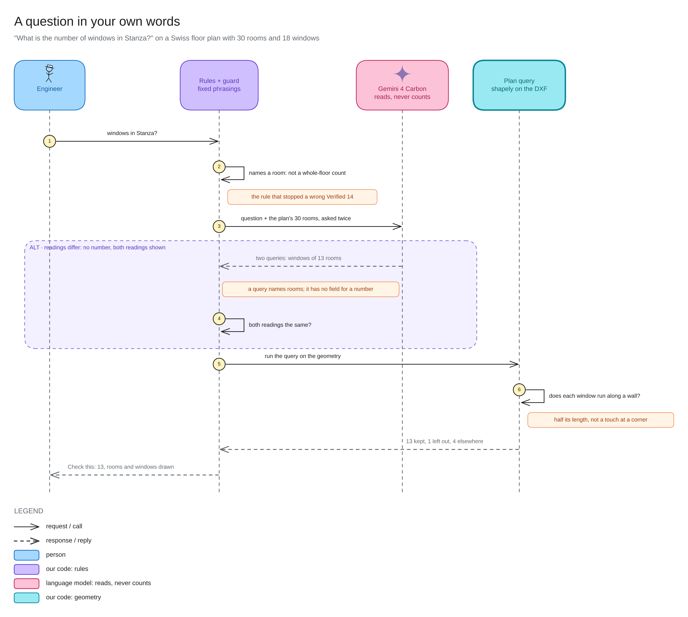
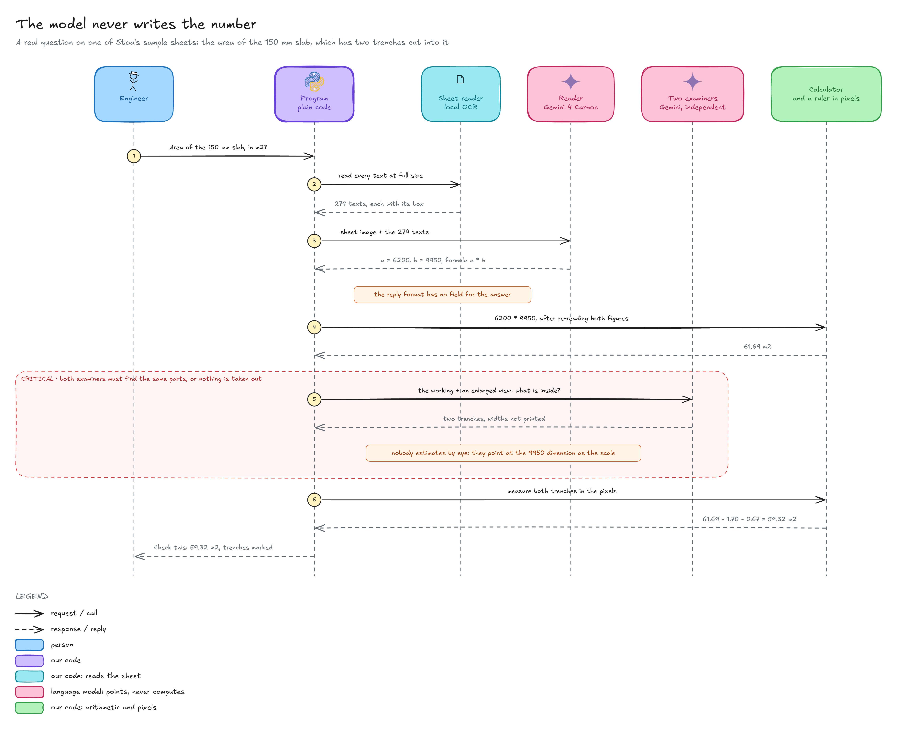
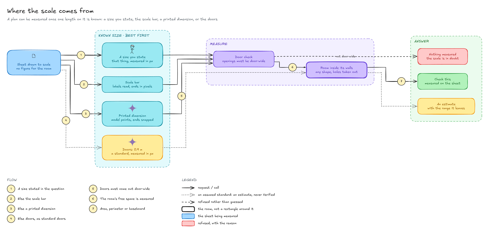
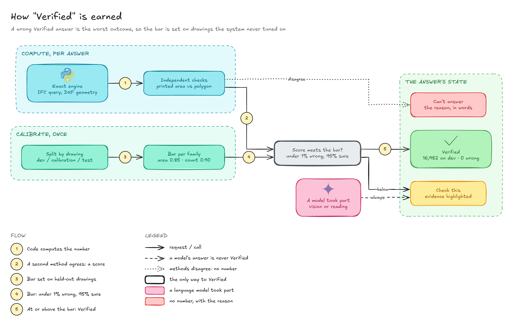

# How Kaava works

One rule holds everywhere: **a number is computed by code from things you can see on the drawing** (counted objects, measured geometry, printed figures). A language model never writes it. Where a model is used at all, its reply format has no field for the answer.

## The path of a question

1. **Route** (`engines/router.py`). Every question names its file. Files with the same name and another extension are the same drawing, and the most structured one wins: IFC, then DXF, then a PDF's vector text, then pixels.
2. **Answer** with the cheapest method that is exact for that drawing (table below).
3. **Check** (`verify.py`). The engine's own cross-checks give the answer a score; the score is compared with a bar set on held-out drawings.
4. **State.** Every answer ends as one of three: **Verified** (no need to double-check), **Check this** (evidence marked, a check is weak or a model took part), **Can't answer reliably** (no number, with the reason).
5. **Evidence.** Whatever was counted or measured comes back as boxes, polygons, model elements and the formula, and the app draws them on the sheet and in 3D.

| Drawing | Engine | What it does | Cost |
| --- | --- | --- | --- |
| IFC model, or a plan rendered from one | `engines/ifc.py` | IfcOpenShell: elements enumerated per storey, geometry and the model's own quantities | free |
| Floor plan with a DXF | `engines/dxf.py` | Room outlines with their holes cut out, door, window and fixture entities; areas checked against the areas printed on the plan | free |
| Scan, counting labelled rooms | `engines/raster_labels.py` | Local OCR (PP-OCR through RapidOCR) reads the room labels; the code counts them and checks the apartment's type line | free |
| Scan, counting symbols | `pointing.py` | The vision model draws a box around each item; the code counts the boxes | about €0.006 |
| Sheet with no model or DXF | `sheet_reading.py` | "Working shown": see below | €0.02 to €0.15 |

## A question in your own words

The exact engines read a fixed set of phrasings. Anything else goes to the language model with the drawing's own list of rooms, storeys and items (`plan_query.py` for DXF plans, `model_query.py` for IFC models). It returns a **query**: which rooms, what to count or measure, how to combine. The engine runs the query on the geometry.

- The question is read **twice**, independently. Readings that differ give no number, and both are shown.
- A guard in the rules refuses a whole-floor count when the question names a room (`dxf.part_named`, `ifc.room_named`).
- A door or a window belongs to a room when at least half of its length runs along one of the room's walls. One that only touches a corner is drawn as left out.
- The rooms searched are drawn before the items counted, so the search itself can be seen.

## Sheets: working shown

A sheet of a drawing set (a slab plan, a schedule, a piping plan) has no geometry behind it. The program first reads **every text at full size** (`sheet_text.py`: the PDF's own text layer, or local OCR tile by tile) and gives the model that list with the image. The model answers in exactly one of five forms, none of which can hold the result:

| Form | The model gives | The program does |
| --- | --- | --- |
| items | the rows or tags that count | counts the list |
| figures + expression | printed figures with their places, and `a * (b + c)` | re-reads each figure where it is printed, evaluates the expression with a calculator that only knows `+ - * /`, converts units |
| text | a short description and where it was read | marks the sources |
| look closer | what counts as one item and where to search | cuts that part into tiles, has each symbol boxed at full size, twice (`tiles.py`); counts what both passes boxed |
| measure | which rooms, with rough boxes | measures them (below) |

Where there is something to work out, it is **worked out twice**; two workings that differ give no number.

### Examiners (`examiner.py`)

A working that multiplies a slab's length by its width is right about the rectangle and can be wrong about the slab. An area or a volume that was multiplied out goes to two examiners: second readers that get the working and an enlarged view, and look **inside** the thing measured for what is not part of it (a trench, a pit, a shaft) or was left out.

- A part sized by printed figures is recomputed by the calculator, when both examiners make the same correction.
- A part with no printed size, drawn as a rectangle in solid lines, is measured in the pixels (`measure.drawn_rectangle`) against a printed dimension the examiner points at, and taken out as a measured deduction.
- Otherwise it is marked on the sheet and the answer says "at most".

### The ruler (`measure.py`, `scale.py`)

A room on a sheet or a scan is **the free space inside its walls**, whatever its shape (`measure.room_shape`): the largest square that fits is slid around the room, so it cannot leave through a door or a window; nooks are added, a closet behind a door is not; columns, shafts and cores standing in it are holes, taken out and drawn. A plain rectangular room is measured as its rectangle and checked against that outline.

The scale comes from the best thing on the sheet that has a known size: a graphic scale bar; else a printed dimension (the ends of its dimension line are found in the pixels); else the doors, taken as standard doors 0.9 m wide. The last is an estimate, shown with the range it leaves open. The same standard checks the other two: door openings measured at the sheet's scale must come out as wide as doors are, or nothing is measured.

## How "Verified" is earned

Only the exact engines can be Verified, and only where a second, independent source agrees (the outline of a room against the area printed in it, for instance). The bar for each family of answers is set on the **calibration split**, drawings the engines were not built on: the largest score threshold at which the error rate among Verified answers stays under 1% with 95% confidence. An answer that rests on a model's reading, or on an assumed standard, is never Verified.

## In 3D

`mesh.py` builds one binary mesh per drawing: an IFC model's elements (in a process of its own, cached), a DXF plan raised from its walls, doors and rooms, and a scan raised from the walls found in its own pixels (`scan_plan.py`: no model is asked; a scan whose walls cannot be told from the rest has no 3D view). Counted items are lit in place.

## What is kept

| Where | What | Why |
| --- | --- | --- |
| `cache/dxf`, `cache/ifc`, `cache/sheet_text`, `cache/ocr` | indexes of drawings | parsed once |
| `cache/mesh`, `cache/scan_plan` | 3D meshes, a scan's walls | built once, keyed by the file's content |
| `cache/readings` | the two readings of a free-form question | a paid reading is asked once; the count is redone each time |
| `cache/answers`, `examples/answers` | answers a model took part in | shown again at no cost |
| `results/` | every evaluation run | see [EVALUATION.md](EVALUATION.md) |

## Module map

| Module | Role |
| --- | --- |
| `engines/` | IFC and DXF engines with their indexes, the label reader, the router |
| `plan_query.py`, `model_query.py` | free-form questions as queries |
| `sheet_text.py`, `sheet_reading.py`, `tiles.py`, `examiner.py` | sheets: texts, the working, tiles, examiners |
| `measure.py`, `scale.py`, `scan_plan.py` | pixels: rooms, rectangles, scale, walls |
| `verify.py`, `scoring.py`, `harness.py`, `split.py` | thresholds, the scoring rule, runs, the split |
| `vlm.py`, `pointing.py`, `interpret.py` | the model adapters (Gemini, Claude, a mock) and what they are asked |
| `server.py`, `mesh.py`, `cloud.py`, `sheet.py` | the API, 3D, Cloudinary, the evidence sheet |
